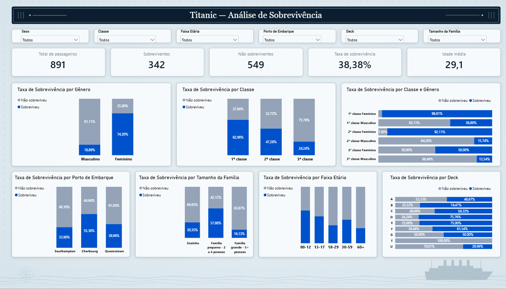

# Titanic — Análise de Sobrevivência

Projeto de análise de dados desenvolvido com **Databricks, PySpark, Delta Lake, SQL e Power BI**, utilizando o conjunto de dados histórico do Titanic.

O objetivo é demonstrar um fluxo de trabalho de análise de dados, desde a ingestão e preparação da base até a construção de indicadores, identificação de padrões e apresentação dos resultados em um dashboard interativo.

## Dashboard



*Dashboard interativo desenvolvido no Power BI.*

## Objetivos do projeto

- Construir um fluxo de dados organizado segundo a arquitetura Medallion.
- Aplicar técnicas de limpeza, transformação e validação de dados.
- Criar tabelas analíticas para responder a perguntas de negócio.
- Desenvolver indicadores e análises com SQL e PySpark.
- Construir um dashboard interativo no Power BI.
- Comunicar os principais resultados por meio de visualizações e indicadores.

## Tecnologias utilizadas

- **Databricks:** ambiente de processamento e análise de dados.
- **Python e PySpark:** ingestão, transformação e preparação dos dados.
- **Delta Lake:** armazenamento das tabelas analíticas.
- **SQL:** consultas, agregações e criação de indicadores.
- **Power Query:** preparação de campos utilizados no relatório.
- **DAX:** criação de medidas para os cartões e indicadores do Power BI.
- **Power BI:** construção do dashboard interativo.
- **GitHub:** versionamento e documentação do projeto.

## Fonte dos dados

Foi utilizado o conjunto de dados Titanic disponibilizado no Kaggle:

[ Titanic Dataset — Kaggle ](https://www.kaggle.com/datasets/yasserh/titanic-dataset)

A base utilizada contém **891 passageiros**, com informações sobre sobrevivência, sexo, idade, classe da passagem, tarifa, cabine, porto de embarque e composição familiar.

## Arquitetura de dados

O projeto foi estruturado segundo a arquitetura Medallion, dividida em três camadas.

### Bronze — Ingestão

- Ingestão da base original.
- Armazenamento dos dados em tabela Delta.
- Verificação inicial de volume, duplicidades e valores ausentes.

### Silver — Preparação e qualidade

- Renomeação das colunas para português.
- Padronização dos valores categóricos de sexo e porto de embarque.
- Tratamento de idades ausentes por meio da mediana agrupada por classe e sexo.
- Extração do deck a partir da informação de cabine.
- Classificação de cabines ausentes como desconhecidas.
- Tratamento dos valores ausentes no porto de embarque.
- Validação da qualidade dos dados após as transformações.

### Gold — Análises e indicadores

Criação de tabelas analíticas para investigar:

- Indicadores gerais de sobrevivência.
- Sobrevivência por sexo.
- Sobrevivência por faixa etária.
- Sobrevivência por classe da passagem.
- Sobrevivência por porto de embarque.
- Sobrevivência por deck.
- Sobrevivência por combinação de classe e sexo.

## Principais resultados

A análise da base revelou os seguintes padrões descritivos:

| Indicador | Resultado |
|---|---:|
| Total de passageiros | 891 |
| Sobreviventes | 342 |
| Não sobreviventes | 549 |
| Taxa geral de sobrevivência | 38,38% |
| Taxa de sobrevivência feminina | 74,20% |
| Taxa de sobrevivência masculina | 18,89% |

### Diferenças por classe

A taxa de sobrevivência apresentou diferenças entre as classes:

- **1ª classe:** 62,96%.
- **2ª classe:** 47,28%.
- **3ª classe:** 24,24%.

### Diferenças por faixa etária

As taxas variaram entre os grupos etários analisados. Crianças de 0 a 12 anos apresentaram taxa de sobrevivência de 57,97%, enquanto adultos jovens de 18 a 29 anos apresentaram 32,03%.

### Classe e sexo

A combinação entre classe e sexo evidenciou diferenças relevantes. A taxa de sobrevivência foi de 96,81% para mulheres da primeira classe e de 13,54% para homens da terceira classe.

### Composição familiar

A análise exploratória também identificou diferenças conforme o tamanho da família a bordo:

- Viajando sozinho: 30,35%.
- Família pequena, de 2 a 4 pessoas: 57,88%.
- Família grande, com 5 ou mais pessoas: 16,13%.

Esses resultados são associações observadas na base histórica e não demonstram, isoladamente, relações de causa e efeito.

## Dashboard interativo

O relatório foi desenvolvido no Power BI e inclui:

- Cinco cartões de indicadores gerais.
- Sete gráficos analíticos.
- Seis filtros interativos: sexo, classe, faixa etária, porto de embarque, deck e tamanho da família.
- Dicas de ferramenta para contextualizar categorias específicas, como cabines desconhecidas e registros atípicos.

Os filtros permitem explorar os indicadores e as visualizações por diferentes grupos de passageiros.

## Estrutura do repositório

```text
projeto-titanic/
├── README.md
├── notebooks/
│   ├── 01_setup_catalogo.ipynb
│   ├── 02_bronze_ingestao.ipynb
│   ├── 03_silver_transformacao.ipynb
│   ├── 04_gold_analytics.ipynb
│   └── 05_analise_exploratoria.ipynb
├── powerbi/
│   └── projeto_titanic.pbix
└── images/
    ├── imagem-de-fundo.png
    └── dashboard-final.png
```

## Como explorar o projeto

1. Consulte os notebooks na ordem indicada para acompanhar a ingestão, preparação e análise dos dados.
2. Consulte a camada Gold para entender os indicadores e as agregações utilizadas.
3. Visualize a captura de tela do dashboard.
4. Abra o arquivo Power BI para explorar os filtros e as visualizações, caso tenha o Power BI Desktop instalado.

A execução dos notebooks em outro ambiente pode exigir ajustes de catálogo, volumes, caminhos de arquivos e permissões do Databricks.

## Considerações finais

Este projeto demonstra a aplicação integrada de engenharia e análise de dados, desde a preparação de uma base até a geração de indicadores e sua comunicação por meio de Business Intelligence.

A análise tem caráter exploratório e se limita às informações disponíveis no conjunto de dados utilizado.
